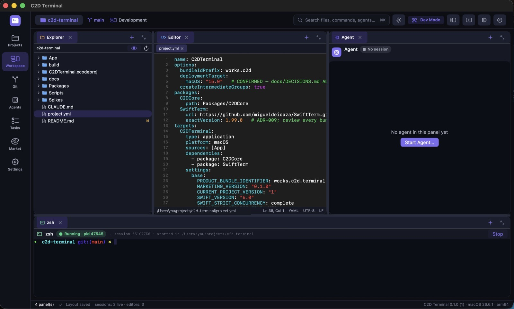

# C2D Terminal

**Cozy terminal. Serious work.**

A native Mac workspace where Claude Code, Git and a real terminal all get along: terminals, an
editor, Git and agent sessions side by side in one comfy window. Agents propose, you decide.



[Watch the demo (45 s)](Website/demo.mp4)

> **Status: early.** C2D Terminal is usable day to day, but there are no signed or notarized builds
> yet. Build it from source (below).

## Features

- **Real terminals.** Every shell and agent runs in a genuine PTY (SwiftTerm on top of C2D's own PTY
  core) with your login shell, config and `PATH`. 10 000-line scrollback; the panel shows the
  kernel-reported working directory and foreground command.
- **Claude Code sessions.** Launch Claude Code into a C2D-owned terminal for the current project,
  optionally with a task as the first prompt. Each launch gets its own session id.
- **Editor and explorer.** File tree with file operations, a native text editor with syntax
  highlighting, go-to-line, project-wide search, and clickable `file:line` paths in terminal output.
- **Git.** Status, diff, stage/unstage per file or per hunk, commit (optionally with an AI-written
  message), branches, worktrees, merge-conflict resolution, file history, and explicit Fetch / Pull /
  Push. Nothing is committed or pushed unless you press the button.
- **Layouts.** Dockable, splittable panels saved per project, layout presets, several projects open
  as pages, and terminal windows with native tabs and split panes.
- **Tasks.** A per-project task list with dependencies that can hand a task to an agent.
- **Command palette** (⌘K / ⌘P), runtime themes (including a light theme), and a diagnostics export
  that redacts secrets and your username.
- **Token Saver** (free, optional, see below).

## Token Saver

Token Saver helps you see and reduce the context you hand to agents. It uses no AI and makes no
model calls of its own.

- **Usage:** reads the token usage fields from Claude Code's own local transcripts
  (`~/.claude/projects`) and shows them per project and session. Read-only; nothing is stored,
  copied or uploaded.
- **Condensing:** context you pick explicitly (terminal output, diffs, files, notes) is cleaned up
  deterministically before you hand it to an agent (copy as Markdown or write `.c2d/context.md`):
  terminal output is condensed, exact duplicates and whitespace are removed. Lossless by default. Lossy folding is opt-in and never removes lines that
  look like errors, warnings or `file:line` references. The original is always kept.
- **Honest numbers:** usage, estimated reduction and verified savings are kept as three separate
  numbers. Byte sizes are measured; token reductions are labelled as estimates; "tokens saved"
  reads *Not measured yet* until a controlled comparison exists.

An optional paired experiment (`Tools/experiment`) compares hand-off variants with real Claude Code
runs. It makes model calls on your own account only after you type `SPEND` at its prompt.

## Privacy

- There is no C2D server or account. The app makes no network requests of its own.
- Agents run with your own provider accounts and settings. C2D never injects credentials and
  does not change Claude Code's configuration.
- Token Saver reads only usage metadata from local transcripts, on demand.

## Requirements

- macOS 15 or later, Apple Silicon.
- Xcode with Swift 6.1 or later. CI builds with Xcode 16.4.
- [XcodeGen](https://github.com/yonaskolb/XcodeGen): `brew install xcodegen`
- [Claude Code](https://docs.claude.com/en/docs/claude-code) installed, if you want agent sessions.

## Build and run

```sh
./Scripts/run-debug.sh                    # generate the project, build Debug and launch
./Scripts/run-debug.sh /path/to/project   # ...and open that folder
```

Or manually:

```sh
xcodegen generate                                   # C2DTerminal.xcodeproj is generated, not committed
xcodebuild build -project C2DTerminal.xcodeproj -scheme C2DTerminal -configuration Debug \
  -destination 'platform=macOS' -skipPackagePluginValidation
```

Then open `C2DTerminal.xcodeproj` in Xcode and press Run, or launch the built app from DerivedData.

`./Scripts/build-release.sh` produces an ad-hoc-signed Release zip in `build/`. Gatekeeper will
refuse it until the app is signed with a Developer ID.

## Development

```sh
swift test --package-path Packages/C2DCore          # core tests (Swift Testing; spawns real shells and git)
```

Edit `project.yml`, not the generated project file. Debug builds accept `-c2d…` launch arguments
for scripted runtime checks; they are listed with comments in `App/Model/AppModel.swift` and are
compiled out of Release builds. In Debug, `C2D_SUPPORT_DIR=<dir>` points all app data at a
throwaway folder.

```
App/                 SwiftUI/AppKit app: workspace canvas, terminal, explorer, editor, Git, agents, tasks, palette, Token Saver
Packages/C2DCore/    Engine-free core: PTY, layouts, persistence (JSON + SQLite), projects, agents, files, Git, tasks, optimizer
Tools/experiment/    Token Saver paired-experiment runner (bundled into the app)
Scripts/             run-debug.sh, build-release.sh
Spikes/              SwiftTerm evaluation harness (not part of the app)
Website/             Landing page
```

## Known limitations

- No signed, notarized or auto-updating builds yet.
- Claude Code is the only verified agent. A Codex launcher exists but is unverified.
- No VoiceOver audit yet.

## Make it yours

C2D Terminal is MIT-licensed, so it's yours too: fork it, bend it, ship your own flavour of it.
Some ideas if you want a place to start:

- **Bring a new agent.** Codex, Gemini CLI, Aider, your own tool: agents plug in through adapters
  in `Packages/C2DCore/Sources/C2DCore/Agents`.
- **Paint a theme.** Four built-in moods so far. Yours could be the fifth.
- **Teach Token Saver a trick.** Better condensing rules for your build tool's noisy output, with
  the original always kept.
- **Sand the rough edges.** Accessibility, keyboard flows, the things that annoy you every day.

Found a bug, have an idea, or built something cool on top? Open an issue or a pull request, we'd
love to see it. Small fixes are just as welcome as big features. Please run
`swift test --package-path Packages/C2DCore` before opening a pull request.

## License

MIT. See [LICENSE](LICENSE). Uses [SwiftTerm](https://github.com/migueldeicaza/SwiftTerm) (MIT).
