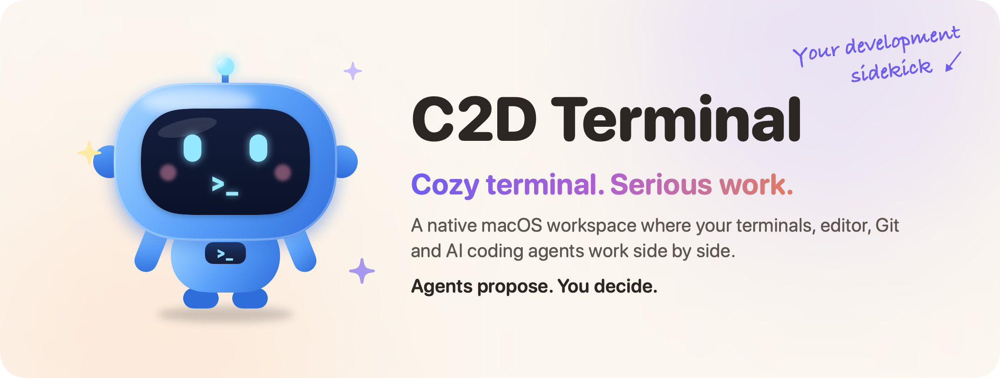
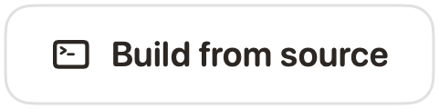
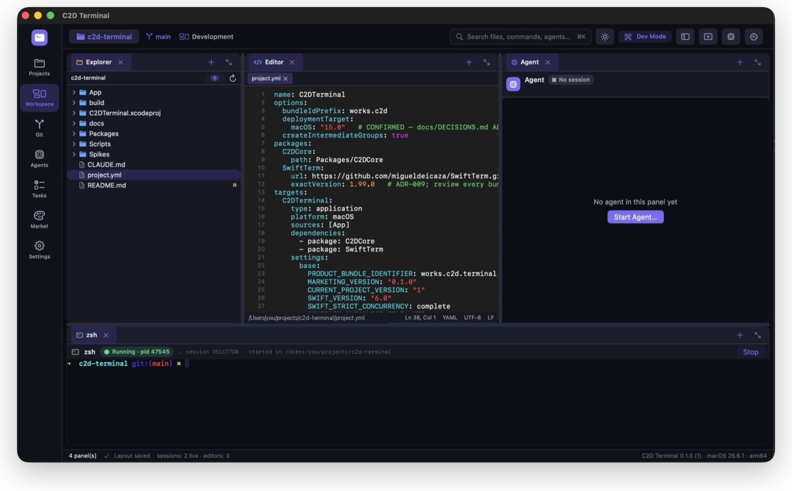
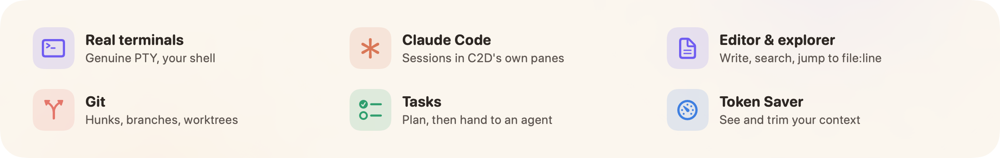

<p align="center">
  
</p>

<p align="center">
  <a href="#see-it-in-action"></a>&nbsp;
  <a href="#build-and-run"></a>&nbsp;
  <a href="#make-it-yours"></a>
</p>

<p align="center">
  
</p>

<p align="center">
  
</p>

## See it in action

A quick 45-second tour: open a project, work beside Claude Code, run the tests and review the
changes in Git.

https://github.com/user-attachments/assets/faf51b06-3f14-49f6-a3ef-1ebacfdd79eb

<table>
  <tr>
    <td width="33%" valign="top">
      <br>
      <b>Open source</b><br>
      MIT licensed. Fork it, bend it, ship your own flavour of it.<br>
      <a href="#make-it-yours">Make it yours →</a>
    </td>
    <td width="33%" valign="top">
      <br>
      <b>Privacy first</b><br>
      No C2D server, no account. Your agents run with your own provider access.<br>
      <a href="#privacy">How it handles your data →</a>
    </td>
    <td width="33%" valign="top">
      <br>
      <b>Early stage</b><br>
      Usable day to day, but there are no signed or notarized builds yet.<br>
      <a href="#build-and-run">Build from source →</a>
    </td>
  </tr>
</table>

## Why C2D Terminal?

A calmer, more connected way to work with code and AI agents.

<table>
  <tr>
    <td width="25%" valign="top">
      <br>
      <b>Everything in one place</b><br>
      Terminals, editor, Git and agents side by side. No more hopping between five apps.
    </td>
    <td width="25%" valign="top">
      <br>
      <b>You stay in control</b><br>
      Agents propose changes. You review them, and nothing is committed or pushed until you press the button.
    </td>
    <td width="25%" valign="top">
      <br>
      <b>Built for real workflows</b><br>
      Worktrees, split panes, several projects open as pages, tasks, and a ⌘K palette.
    </td>
    <td width="25%" valign="top">
      <br>
      <b>Know your context</b><br>
      Token Saver shows what your sessions use and trims what you hand over, without guessing.
    </td>
  </tr>
</table>

## Features

- **Real terminals.** Every shell and agent runs in a genuine PTY (SwiftTerm on top of C2D's own PTY
  core) with your login shell, config and `PATH`. 10 000-line scrollback; the panel shows the
  kernel-reported working directory and foreground command.
- **Claude Code sessions.** Launch Claude Code into a C2D-owned terminal for the current project,
  optionally with a task as the first prompt. Each launch gets its own session id.
- **Editor and explorer.** File tree with file operations, a native text editor with syntax
  highlighting, go-to-line, project-wide search, and clickable `file:line` paths in terminal output.
- **Git.** Status, diff, stage and unstage per file or per hunk, commit (optionally with a message
  written by Claude Code), branches, worktrees, merge-conflict resolution, file history, and explicit
  Fetch / Pull / Push.
- **Layouts.** Dockable, splittable panels saved per project, layout presets, several projects open
  as pages, and terminal windows with native tabs and split panes.
- **Tasks.** A per-project task list with dependencies; a task can be handed to an agent at launch.
- **Command palette** (⌘K / ⌘P), four built-in themes including a light one, and a diagnostics
  export that redacts secrets and your username.
- **Buddy.** A small desktop companion you can summon from the sidebar. Purely decorative: no chat,
  no AI, no network.
- **Token Saver.** Free and optional, see below.

## Token Saver

Token Saver helps you see and reduce the context you hand to agents. It uses no AI and makes no
model calls of its own.

- **Usage.** Reads the token usage fields from Claude Code's own local transcripts
  (`~/.claude/projects`) and shows them per project and session. Read-only and on demand; nothing is
  stored, copied or uploaded.
- **Condensing.** Context you pick explicitly (terminal output, diffs, files, notes) is cleaned up
  deterministically before you hand it to an agent, by copying it as Markdown or writing
  `.c2d/context.md`. Terminal output is condensed, and exact duplicates and extra whitespace are
  removed. Lossless by default. Lossy folding is opt-in and never removes lines that look like
  errors, warnings or `file:line` references. The original is always kept.
- **Honest numbers.** Usage, estimated reduction and verified savings are three separate numbers
  and are never added together. Byte sizes are measured, token reductions are labelled as
  estimates, and "tokens saved" reads *Not measured yet* until a controlled comparison exists.

An optional paired experiment (`Tools/experiment`) compares hand-off variants with real Claude Code
runs. It makes model calls on your own account only after you type `SPEND` at its prompt.

## Privacy

- There is no C2D server or account, and the app makes no network requests of its own.
- Agents run with your own provider accounts and settings. C2D never injects credentials and does
  not change Claude Code's configuration.
- Token Saver reads only usage metadata from local transcripts, on demand.

## Requirements

- macOS 15 or later on Apple Silicon.
- Xcode with Swift 6.1 or later (CI builds with Xcode 16.4).
- [XcodeGen](https://github.com/yonaskolb/XcodeGen).
- [Claude Code](https://docs.claude.com/en/docs/claude-code), if you want agent sessions.

Install XcodeGen:

```sh
brew install xcodegen
```

## Build and run

The quickest way: generate the project, build Debug and launch the app.

```sh
./Scripts/run-debug.sh
```

Launch it with a project already open:

```sh
./Scripts/run-debug.sh /path/to/project
```

### Manual build

`C2DTerminal.xcodeproj` is generated from `project.yml` and is not committed. Generate it:

```sh
xcodegen generate
```

Build the Debug app:

```sh
xcodebuild build -project C2DTerminal.xcodeproj -scheme C2DTerminal -configuration Debug -destination 'platform=macOS' -skipPackagePluginValidation -skipMacroValidation
```

Or open `C2DTerminal.xcodeproj` in Xcode and press Run.

### Release package

```sh
./Scripts/build-release.sh
```

This writes `build/C2DTerminal.app` and `build/C2DTerminal-<version>-unsigned.zip`. The app is
ad-hoc signed, so Gatekeeper will refuse it on other Macs until it is signed with a Developer ID.

## Development

Run the core tests (Swift Testing; they spawn real shells and real `git`):

```sh
swift test --package-path Packages/C2DCore
```

Edit `project.yml`, not the generated project file. Debug builds accept `-c2d…` launch arguments
for scripted runtime checks; they are listed with comments in `App/Model/AppModel.swift` and are
compiled out of Release builds. In Debug, the `C2D_SUPPORT_DIR=<dir>` environment variable points
all app data at a throwaway folder.

```
App/                 SwiftUI/AppKit app: workspace canvas, terminal, explorer, editor, Git, agents, tasks, palette, Token Saver, Buddy
Packages/C2DCore/    Engine-free core: PTY, layouts, persistence (JSON + SQLite), projects, agents, files, Git, tasks, optimizer
Tools/experiment/    Token Saver paired-experiment runner (bundled into the app)
Tools/readme/        Renders the README artwork in .github/readme (./Tools/readme/render.sh)
Scripts/             run-debug.sh, build-release.sh
Spikes/              SwiftTerm evaluation harness (not part of the app)
Website/             Landing page, screenshots and the demo video
```

## Known limitations

- No signed, notarized or auto-updating builds yet.
- Claude Code is the only verified agent. A Codex launcher exists but is unverified.
- No VoiceOver audit yet.

## Make it yours

C2D Terminal is MIT-licensed, so it's yours too: fork it, bend it, ship your own flavour of it.
Some ideas if you want a place to start:

- **Bring a new agent.** Codex, Gemini CLI, Aider, your own tool. Each CLI agent is described in
  `Packages/C2DCore/Sources/C2DCore/Agents/AgentProvider.swift`: its executable, launch arguments
  and the capabilities that have actually been verified.
- **Paint a theme.** Four built-in moods so far, defined in `App/Design/ThemeManager.swift`. Yours
  could be the fifth.
- **Teach Token Saver a trick.** Better condensing rules for your build tool's noisy output, with
  the original always kept.
- **Sand the rough edges.** Accessibility, keyboard flows, the things that annoy you every day.

Found a bug, have an idea, or built something cool on top? Open an issue or a pull request, we'd
love to see it. Small fixes are just as welcome as big features. Please run the core tests before
opening a pull request.

## License

MIT. See [LICENSE](LICENSE). Uses [SwiftTerm](https://github.com/migueldeicaza/SwiftTerm) (MIT).
